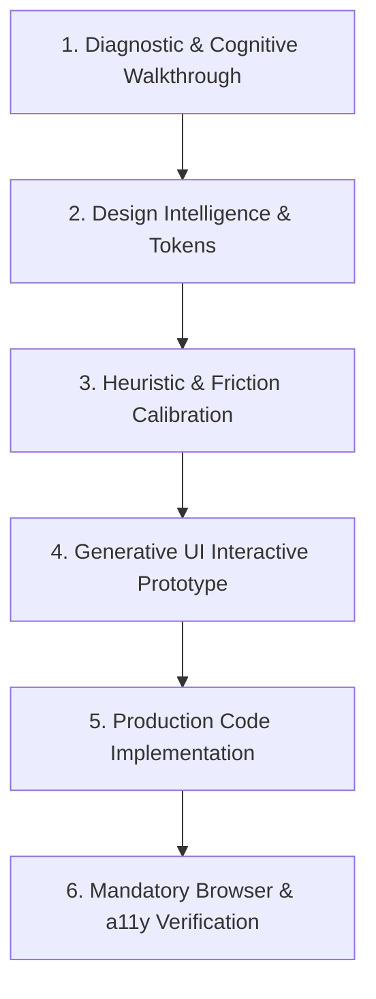

# UX Optimizer Skill

The **UX Optimizer** skill guides you through auditing, architecting, and optimizing user interfaces and product flows to achieve institutional-grade usability, delightful micro-interactions, uncompromising accessibility, and high conversion.

---

## Prerequisites & Architecture

- **Python 3**: For automated auditing scripts and `ui-ux-pro-max` search queries.
- **Browser tools** (Playwright MCP, Chrome DevTools MCP, or a built-in browser): For live visual and accessibility verification.
- **Reference Guides**:
  - [WCAG 2.2 AA Checklist](./references/wcag-2.2-checklist.md)
  - [FinTech & Banking Heuristics](./references/fintech-banking-heuristics.md): only for finance, payments, or banking products.
  - [Generative UI Patterns](./references/generative-ui-patterns.md): Antigravity's inline `<agent-embed>` widgets; skip on other agents.
- **Helper Scripts**:
  - Code Auditor: `python3 .agents/skills/ux-optimizer/scripts/audit_ux.py audit <path>`
  - Prototype Scaffolder: `python3 .agents/skills/ux-optimizer/scripts/audit_ux.py prototype "<Title>" -o <output.html>`
  - UI Pro Max Engine (optional, separate skill): `python3 .agents/skills/ui-ux-pro-max/scripts/search.py`. Not installed? `npx skills add nextlevelbuilder/ui-ux-pro-max-skill --skill ui-ux-pro-max`, or skip Step 2.

---

## End-to-End Optimization Workflow

Follow this 6-step protocol for every UX task:



### Step 1: Diagnostic & Cognitive Walkthrough
Before modifying code, perform a structured diagnosis:
1. **Identify the Core Task**: What is the single primary goal of the user on this screen?
2. **Cognitive Load Assessment**: Are there distracting secondary elements, redundant inputs, or visual noise?
3. **Automated Audit**: Run the UX auditor on the target component or directory:
   ```bash
   python3 .agents/skills/ux-optimizer/scripts/audit_ux.py audit <path/to/component-or-dir>
   ```
4. **Identify Friction Types**:
   - *Nuisance Friction* (must be eliminated): Clunky date pickers, manual formatting of structured inputs (phone, card, IBAN), excessive clicks.
   - *Protective Friction* (must be added/calibrated): Irreversible actions (payments, deletions, publishing, account changes) requiring summary review cards and undo windows.

### Step 2: Retrieve Design Intelligence (`ui-ux-pro-max`, if installed)
Fetch tailored design guidelines, color palettes, and typography pairings matching the domain:
```bash
python3 .agents/skills/ui-ux-pro-max/scripts/search.py "<product_type> <keywords>" --design-system
```
- Match the palette to the domain (e.g. for finance: trust-oriented Navy, Slate, Deep Emerald accents with clean geometric or humanist sans-serifs).
- If the project has a design system (e.g. `design-system/MASTER.md`, a tokens file, or a Tailwind theme), align with its existing brand tokens.

### Step 3: Enforce WCAG 2.2 AA Standards
Ensure the target interface satisfies all Level AA requirements:
- **Target Size (2.5.8)**: Interactive elements have at least $24 \times 24\text{px}$ bounds ($44 \times 44\text{px}$ recommended for mobile touch).
- **Focus Not Obscured (2.4.11)**: Focus indicators are never hidden behind sticky headers/footers (`scroll-padding-top`).
- **Focus Rings**: Never use `outline-none` alone; always pair with `focus-visible:ring-2 focus-visible:ring-primary`.
- **Contrast**: $\ge 4.5:1$ for body copy, $\ge 3:1$ for input borders and graphical badges.
- **Dragging Alternatives (2.5.7)**: Provide discrete buttons/inputs for any drag interaction.

### Step 4: Generate Interactive Prototype (Generative UI)
When redesigning a screen or presenting layout options to the user, create a self-contained interactive HTML prototype. Show it the way your agent supports (an artifact or preview pane, or by giving the user the file path to open):
1. Scaffold or write the HTML file:
   ```bash
   python3 .agents/skills/ux-optimizer/scripts/audit_ux.py prototype "Optimized Checkout Modal" -o <output-dir>/checkout_preview.html
   ```
2. Use semantic CSS variables so the prototype maps onto the real theme:
   - Surfaces: `bg-[var(--card)]`, `bg-[var(--background)]`
   - Text: `text-[var(--foreground)]`, `text-[var(--muted-foreground)]`
   - Borders: `border-[var(--border)]`
   - Accents: `bg-[var(--primary)]`, `text-[var(--primary-foreground)]`
3. On Antigravity, you can embed it inline in chat: see [Generative UI Patterns](./references/generative-ui-patterns.md).

### Step 5: Implement Production Code
Translate the approved UX design into frontend code:
- **Tabular Figures**: Format amounts, metrics, and tables of numbers with `tabular-nums` or `font-mono`.
- **Instant Micro-Interactions**: Add loading spinners, button morphing on click, and hover elevation (`active:scale-[0.98]`).
- **Optimistic States**: Render success state immediately for low-risk actions with rollback on network error.
- **Actionable Errors**: Avoid cryptic error messages; explain *what happened*, *why*, and *how to fix it*.

### Step 6: Mandatory Browser Verification (`/ui-ux-testing`)
In accordance with repository rules, verify all frontend modifications:
1. Ensure the development server is running (dev command and URL in `AGENTS.md`).
2. Run browser tests or inspection with your browser tools:
   - Check developer console: zero errors or warnings.
   - Test keyboard navigation: Tab sequence, focus rings visible, modal traps working.
   - Verify responsiveness: Emulate mobile ($375\text{px}$), tablet ($768\text{px}$), and desktop ($1280\text{px}$).
   - Verify color contrast and touch targets.

